# Nightly Demoparty

**An unattended creative coding crew that researches, builds, judges and publishes one demoscene piece every night on GitHub Actions.**

[Live Gallery](https://aieatassam.github.io/nightly-demoparty/) · [Architecture Spec](SPEC.md) · [Design Decisions](DECISIONS.md) · [Setup Guide](SETUP.md)

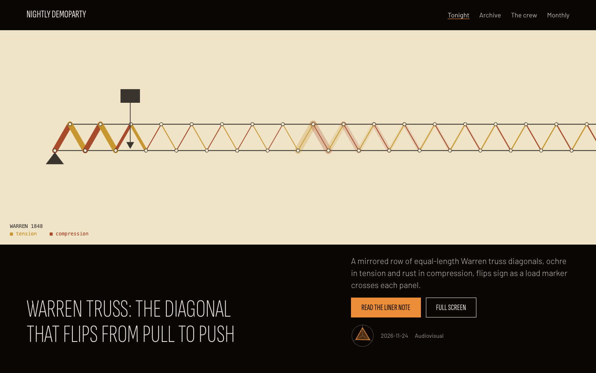

<sub>Gallery front page. This is a preview build rendered from the three local dry runs in <code>audit/dry-runs/</code>, not from live nightly output.</sub>

## What it is and why

Nightly Demoparty is an autonomous creative coding system in the demoscene tradition. It runs unattended on GitHub Actions. The only secret it uses is `CLAUDE_CODE_OAUTH_TOKEN`.

Every night it:

1. **Plans.** A script picks a compo (one of 8, see [Compos and size budgets](#compos-and-size-budgets)) and a domain from 60 real-world topics in `config/domains.yml`, plus constraints and bans from the ledger.
2. **Researches.** Haiku searches the open web for a visualisable mechanism and writes a sourced dossier.
3. **Feels.** Haiku appraises the dossier, and [`agent-emotion-core`](.claude/skills/agent-emotion-core/) updates the persistent crew emotional state in `state/emotion.json`.
4. **Briefs.** Haiku turns the research and the mood into a creative brief, which must pass Novelty Gate A.
5. **Builds.** One self-contained single-file HTML/CSS/JS piece under the compo's byte budget. Haiku builds attempts 1 and 2. Opus at low effort builds attempt 3.
6. **Gates.** Deterministic Playwright hard gates in headless Chromium with SwiftShader, plus visual novelty checks (Novelty Gate B).
7. **Judges.** A 3-sample median Haiku `--effort high` vision jury, calibrated against 12 anchor pieces with agreed scores.
8. **Publishes.** A Hallmark-audited static gallery on GitHub Pages, with the full audit trail.

Two slower loops sit on top:

- **Weekly.** An Opus low-effort retrospective reviews the verdicts and the ledger. It grows `config/slop.yml` and `config/curriculum.yml` and ratchets the publish threshold within 72 to 85.
- **Monthly.** A no-LLM script publishes a best-of-month showcase page from the top scores.

Weak work is retried with the critique. Work that clears the bar is released to the front page. Everything else goes to the B-sides shelf or a shelved card with its reason. Every night leaves an audit trail: research, mood, brief, each attempt, scores and verdicts.

## How the nightly pipeline works

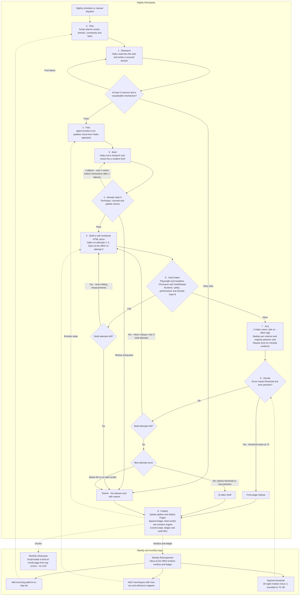

### Stage reference

| Stage | Runner / Model | Tools & Limits | Contract (`schemas/*.schema.json`) | Purpose |
|---|---|---|---|---|
| 0 · Plan | Script (`harness/plan.ts`) | No LLM | `plan` | Seeded pick of compo, domain, constraints and ledger bans |
| 1 · Research | Haiku | `WebSearch,WebFetch,Write`, 15 turns, 1 retry | `dossier` | Sourced dossier with at least 3 sources and a visualisable mechanism |
| 2 · Feel | Haiku + `agent-emotion-core` | `Write`, 3 turns | `appraisals`, `mood` | Appraise tonight's facts, update the crew state, map it to creative levels |
| 3 · Brief | Haiku | `Read,Write`, 6 turns, up to 3 tries | `brief` | Concept, mechanism, storyboard, palette and liner note |
| 4 · Novelty Gate A | Script | No LLM | `brief` (checked against the ledger) | Reject technique, concept and palette collisions |
| 5 · Build | Haiku (attempts 1 and 2), Opus `--effort low` (attempt 3) | `Read,Write,Edit,Bash(npm run gate:*)`, 30 turns | Compo byte budget (`config/compos.yml`) | One self-contained `piece/index.html` |
| 6 · Hard Gates | Script (Playwright, headless Chromium with SwiftShader) | No LLM, fresh folder | `gates` | Static lint, runtime, safety, performance and Novelty Gate B |
| 7 · Jury | Haiku `--effort high`, 3 samples | `Read,Write`, 4 turns each, 1 evidence retry | `verdict` | Median per criterion and majority pairwise vote |
| 8 · Decide | Script (`harness/decide.ts`) | No LLM | Reads `verdict` and `gates` | Release, retry with critique, B-side or shelve |
| 9 · Publish | Script | No LLM, runs on every night | `meta`, `ledger-entry`, `usage-entry` | Gallery build, Pages deploy, ledger row, verdict fed back into the emotion engine |

Key points:

- **Publish always runs.** The `publish` job runs `if: always() && needs.plan.result == 'success'`. Halted nights and nights where every gate failed still route to `Shelve`, so every night writes a shelved card with its reason and a ledger row.
- **Thresholds.** `publish_min` is 72 and `b_side_min` is 60 (`config/thresholds.yml`). The weekly ratchet moves the publish threshold within 72 to 85.
- **Stages are separate Claude Code calls.** Each LLM stage has its own tool allowlist and turn cap. Stages exchange JSON files that are validated against `schemas/`.

## How crew mood shapes the art

`agent-emotion-core` keeps a persistent PAD state (`pleasure`, `arousal`, `dominance`) for the crew, plus derived signals (`interest`, `boredom`, `frustration`). `harness/emotion.ts` maps them to concrete creative parameters that the brief and build prompts must honour:

| Signal | Creative parameter |
|---|---|
| Arousal | Tempo: `low`, `medium` or `high` |
| Pleasure | Palette: `cool-dissonant`, `balanced` or `warm-consonant` |
| Dominance | Scale: `intimate`, `measured` or `assertive` |
| Interest | Risk budget: `conservative` (below 0.5), `moderate` (below 0.75), `experimental` |
| Boredom at or above 0.5 | `boredom_force_unused_30d`: use a technique not seen in the last 30 nights |
| Frustration at or above 0.5 | `shrink_scope`: tighten scope; `polish_weight_boost` equals frustration |

Each night's verdict is fed back into the engine at Stage 9. A release elicits joy and pride, a shelved night elicits distress and shame, and consolidation turns the night's topics into lasting likes and dislikes.

### Acceptance test: 5 moods, same dossier

Five mood presets, one hand-authored Kármán vortex street dossier (`audit/five-moods/dossier.json`), the same `simulation` compo and a 24 KB budget. Each piece was built by Haiku.

<table>
  <tr>
    <td align="center" width="20%"><br><b>Euphoric</b><br><sub>high tempo, warm-consonant, assertive, experimental</sub></td>
    <td align="center" width="20%"><br><b>Melancholic</b><br><sub>low tempo, cool-dissonant, intimate, conservative</sub></td>
    <td align="center" width="20%">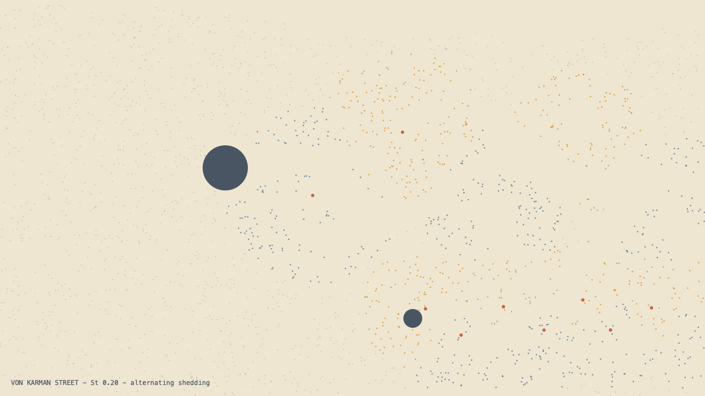<br><b>Bored</b><br><sub>high tempo, balanced, measured, forced unused technique</sub></td>
    <td align="center" width="20%">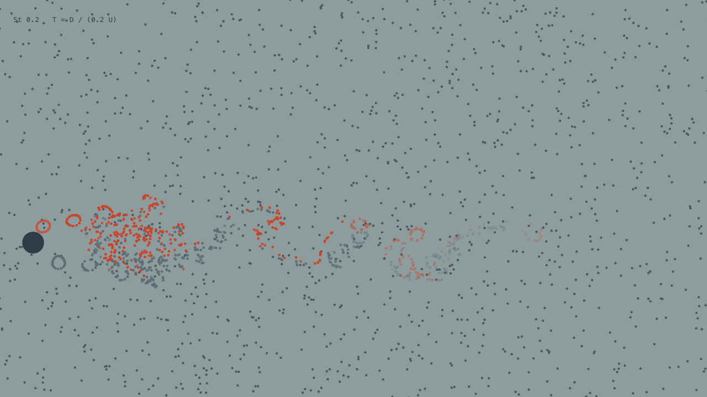<br><b>Frustrated</b><br><sub>high tempo, cool-dissonant, shrink scope, polish 0.88</sub></td>
    <td align="center" width="20%"><br><b>Curious</b><br><sub>high tempo, warm-consonant, measured, experimental</sub></td>
  </tr>
</table>

Verified results (`audit/five-moods/report.json`, reproduce with `npx tsx harness/five-moods-test.ts all`):

- 5/5 pieces passed the real `timingScale = 1` Playwright hard gates on attempt 1.
- A blind Haiku judge, shown shuffled contact strips and the five preset descriptions, matched pieces to moods **15/15 (100%)** with motion telemetry and **13/15 (87%)** on pixels alone. Chance is 1 correct match in 5.

## Gallery preview

The gallery is a Hallmark-audited "Darkroom" UI built from each night's `meta.json`.

<table>
  <tr>
    <td width="50%" valign="top">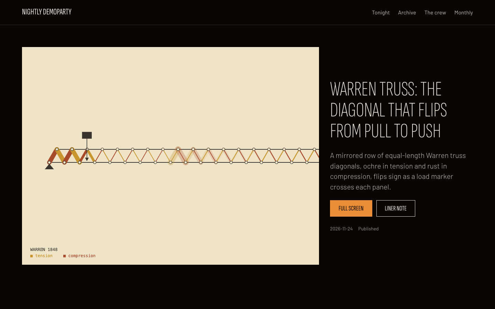<br><b>Piece detail.</b> The live piece, its sourced liner note, an SVG mood plot, the jury evidence and the attempt log.</td>
    <td width="50%" valign="top">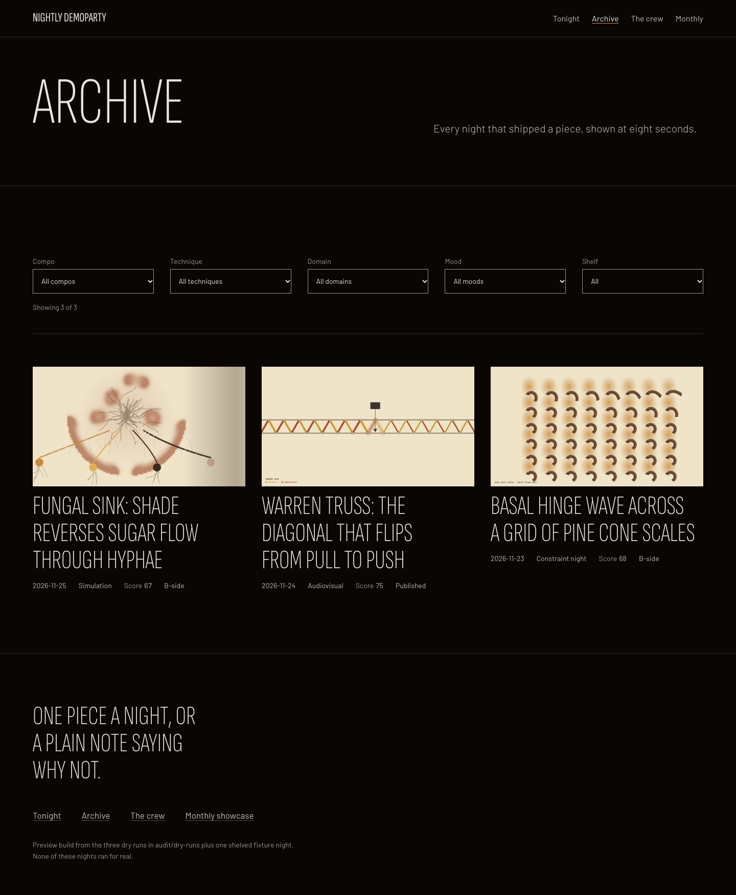<br><b>Archive.</b> A filterable screenshot archive of every night, with the B-sides shelf.</td>
  </tr>
</table>

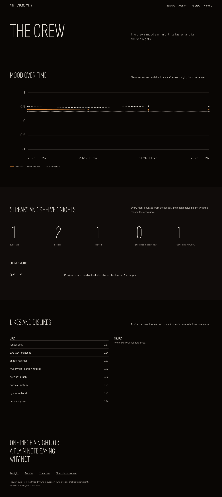

**The crew.** An SVG PAD timeline, streaks, the shelved log and the crew's evolving likes and dislikes.

Implementation facts:

- Zero frontend framework runtime.
- Pure relative URLs, so the site works under the GitHub Pages subpath.
- Every piece runs in `<iframe sandbox="allow-scripts">`, including the dedicated full-screen `stage.html`.
- The build passes Hallmark `sloplint.mjs --render` with 0 FAIL and 0 REFLEX.

## End-to-end local dry runs

Three full local runs of the nightly pipeline (`npm run dry-run -- --max-attempts 3`), with real web research, real builds, real hard gates at `timingScale = 1` and a real jury. The shots are each night's best attempt at 20 s.

<table>
  <tr>
    <td align="center" width="33%">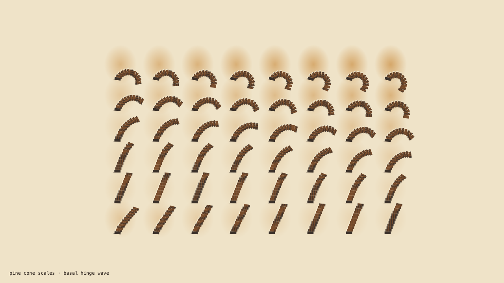</td>
    <td align="center" width="33%">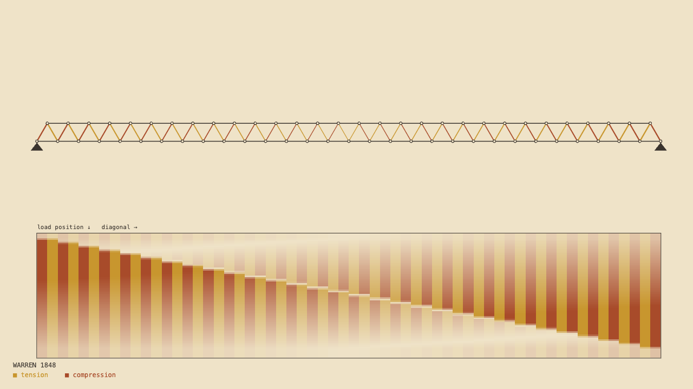</td>
    <td align="center" width="33%">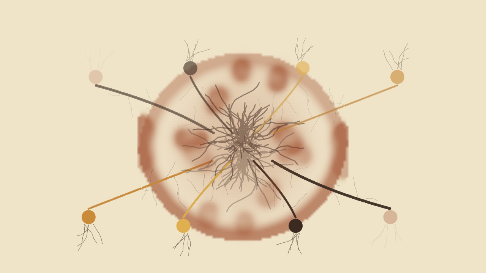</td>
  </tr>
  <tr>
    <td valign="top"><b>Basal hinge wave across a grid of pine cone scales</b><br><code>constraint-night</code> (css-only, 16 KB)<br>Jury: a1 62, a2 68, a3 65<br>B-side (best attempt 2, 68)<br>15 calls, $1.3937</td>
    <td valign="top"><b>Warren truss: the diagonal that flips from pull to push</b><br><code>audiovisual</code> (24 KB)<br>Jury: a1 67, a2 62, a3 69<br>B-side (best attempt 3, Opus, 69)<br>15 calls, $1.6416</td>
    <td valign="top"><b>Fungal Sink: Shade Reverses Sugar Flow Through Hyphae</b><br><code>simulation</code> (24 KB, forced)<br>Jury: a1 64, a2 67, a3 66<br>B-side (best attempt 2, 67)<br>16 calls, $2.1952</td>
  </tr>
</table>

| Run | Topic | Attempt 1 samples | Attempt 2 samples | Attempt 3 samples |
|---|---|---|---|---|
| run-01 | Pine cone scales bend with humidity through discrete fibre bundles | 62 59 64 = **62** | 71 65 68 = **68** | 71 63 66 = **65** |
| run-02 | A Warren truss diagonal flips from tension to compression as the load crosses its panel | 68 64 66 = **67** | 53 63 64 = **62** | 70 71 68 = **69** |
| run-03 | Sink-driven sugar flow through shared mycorrhizal hyphae, reversible under shade | 63 62 67 = **64** | 67 70 67 = **67** | 67 65 67 = **66** |

Totals: 46 LLM calls, $5.23. 9/9 attempts passed the real hard gates and 27/27 jury samples were valid. All three nights ended as B-sides between 67 and 69, under the publish threshold of 72. Full per-stage files are in `audit/dry-runs/run-01..03/`.

## Calibrated anchors and jury

The jury is calibrated against 12 anchor pieces in `anchors/` with agreed scores from 39 to 89 (5 publish, 4 B-sides, 3 shelved). Each anchor was rated blind by two Opus raters and Codex `gpt-6.2-sol`. The agreed score is the per-criterion median, and gaps over 15 points were reconciled by argument against the full-size shots. The four highest-scoring anchors:

<table>
  <tr>
    <td align="center" width="25%"><br><b>Cooling Front</b><br><code>16k-demo</code> · agreed 78</td>
    <td align="center" width="25%">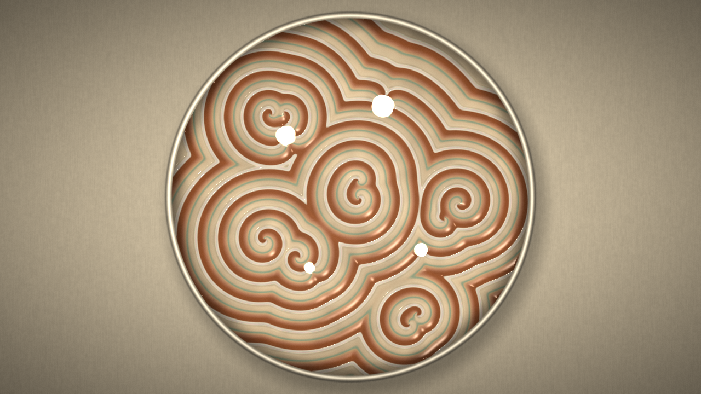<br><b>Winfree Rotors</b><br><code>simulation</code> · agreed 87</td>
    <td align="center" width="25%"><br><b>Pulse Relief</b><br><code>data-sculpture</code> · agreed 89</td>
    <td align="center" width="25%"><br><b>Laplace Chain</b><br><code>audiovisual</code> · agreed 82</td>
  </tr>
</table>

A 12-anchor leave-one-out run of the 3-sample median Haiku `--effort high` jury scored **Spearman rho 0.8278** against the Codex-reconciled scores, with MAE 6.33 and bias -0.83. All 36/36 raw verdicts were valid within 4 turns. The known weakness is scale compression: the four top anchors read 5 to 11 points low (anchor-10 at 87 reads 78, anchor-12 at 82 reads 71), and the three shelved anchors read 6 to 13 points high. Details are in [`DECISIONS.md`](DECISIONS.md) and `audit/calibration/jury-calibration.json`.

## Compos and size budgets

From `config/compos.yml`. Sizes are the whole piece in bytes.

| Compo | Budget | Audio | Constraint |
|---|---|---|---|
| `4k-shader` | 4,096 | No | Single fragment shader, must have a time arc |
| `16k-demo` | 16,384 | No | WebGL2 or WebGPU, multi-scene |
| `audiovisual` | 24,576 | Required | Synthesised sound drives visuals, or the reverse |
| `interactive-toy` | 24,576 | No | Pointer or keyboard changes the system, not just the camera |
| `data-sculpture` | 32,768 | No | A real dataset from the dossier, rendered as form; budget includes inlined data |
| `kinetic-type` | 12,288 | No | SVG or canvas typography, text taken from the research |
| `simulation` | 24,576 | No | A faithful small model of the researched mechanism |
| `constraint-night` | 16,384 | No | One harsh limit per night: `1kb-micro` (1,024 bytes), `two-colour`, `css-only` or `no-canvas` |

## Security and anti-slop architecture

### Untrusted web data

- Everything from the open web is wrapped in `<UNTRUSTED_DOSSIER_DATA>` blocks, and every prompt tells the model to treat it as data only.
- `<` in untrusted values is escaped (`harness/prompt-render.ts`), so a value can never close the block.
- The dossier is capped at 24 KB, and every stage output is validated against strict Draft 2020-12 JSON Schemas in `schemas/`.

### CI isolation

- Each LLM stage gets path-scoped `Edit(//...)` write allowlists.
- A workspace guard runs from `$RUNNER_TEMP` after every call. The guard itself is pure Bash, with no `tsx` or `node`. It enforces a 4-key `.git/config` allowlist and rejects symlinks before any upload.
- `CLAUDE_CODE_SUBPROCESS_ENV_SCRUB=1` on every agent call.
- Least-privilege job permissions. Every workflow defaults to `contents: read`. Only `publish` and `showcase` get `pages: write` and `id-token: write`, and `contents: write` is limited to those two and the weekly `apply` job.
- Every GitHub Action is pinned to a full 40-character commit SHA.
- `publish` reads artifacts only from succeeded jobs with verified guard markers.

### Piece sandboxing and hard gates

- Every piece carries the canonical CSP meta tag: `default-src 'none'; script-src 'unsafe-inline'; style-src 'unsafe-inline'; img-src data: blob:; media-src blob:`.
- Static lint rejects network access, `eval`, navigation, WebRTC and slop patterns.
- Headless Chromium with SwiftShader checks at runtime:
  - no console or network errors;
  - non-blank luminance and real motion;
  - visible development from 2 s to 20 s;
  - a continuous WCAG strobe check over any 9.5% area;
  - a frame-time ceiling;
  - an audio probe for audio compos;
  - `prefers-reduced-motion` support;
  - Novelty Gate B: pHash and a 64-bin RGB histogram against the archive.

### Three-layer anti-slop

1. **Skills.** Vendored and custom skills: `hallmark` for the gallery, `demo-craft` for the piece, `liner-notes` for the prose.
2. **Deterministic lint.** Static and visual lint of every piece and the gallery.
3. **Rolling novelty ledger.** `ledger/ledger.jsonl` records every night's technique, concept and palette, and both novelty gates check against it. The weekly retrospective adds recurring patterns to `config/slop.yml`.

## Repository layout

```
.github/workflows/   nightly.yml  weekly.yml  monthly.yml  ci.yml
.github/actions/agent/  composite action that runs one Claude Code stage
.claude/skills/      hallmark/  demo-craft/  liner-notes/  agent-emotion-core/   (vendored, see NOTICE)
prompts/             research.md  appraise.md  brief.md  build.md  jury.md  retro.md
schemas/             JSON Schemas for plan, dossier, appraisals, mood, brief, gates, verdict, meta, ledger-entry, usage-entry, retro
config/              domains.yml  compos.yml  curriculum.yml  thresholds.yml  slop.yml
harness/             TypeScript: plan, novelty, gates (Playwright), decide, publish, lint, dry run
lib/                 inlineable helpers for pieces
anchors/             12 calibration pieces with agreed scores
state/               emotion.json (persistent crew mood)
ledger/              ledger.jsonl (one row per night)
audit/               per-night folders: every stage's input, output and usage
docs/screenshots/    gallery preview captures used in this README
site/                gallery source (builds to site/dist/)
tests/               Vitest suites
```

## Local development, tests, and dry runs

### Prerequisites

- Node `>=22.4.0`
- Python 3 (needed by `agent-emotion-core`)
- Playwright Chromium (installed in the setup step below)
- The local `claude` CLI, only for LLM dry runs. Deterministic tests and gates need no LLM.

### Setup

```sh
npm ci && npx playwright install --with-deps chromium
```

### Checks

```sh
npm run typecheck     # tsc --noEmit
npm test              # Vitest suites (deterministic, no LLM)
```

### Hard gates on a single piece

```sh
npm run gate -- <path-to-piece.html> --compo <compo-id> --out <out-dir>
```

Example: `npm run gate -- piece/index.html --compo constraint-night --out out/gate`. Compo IDs are in `config/compos.yml`. Other useful flags, from `harness/cli.ts`:

- `--budget N` overrides the compo's size budget in bytes.
- `--audio` runs the audio probe.
- `--constraint X` applies a compo constraint (for example `1kb-micro`).
- `--timing-scale N` scales timing thresholds (useful on slow machines).
- `--ledger P` and `--date D` pass ledger and date context to the novelty checks.

The command writes the gate results and screenshots to `--out`. It exits `0` on pass, `1` on a failed check, and `2` on a usage or runtime error.

### Local dry run

```sh
npm run dry-run -- --out <out-dir>
```

This runs the full nightly pipeline on your machine with the local `claude` CLI. It writes everything under `--out` and never touches the repository's `state/emotion.json`, `ledger/ledger.jsonl`, `audit/usage.jsonl`, or `site/pieces/`.

Flags, from `harness/dry-run.ts`:

- `--out DIR` (required): the night folder for every output.
- `--date D`: the night's date (defaults to today, UTC).
- `--seed S`: seeds the planner's choices.
- `--max-attempts 1..3`: build attempts per night. Defaults to 3. Use `1` for a cheap smoke run.
- `--force-domain X`: pick a domain id from `config/domains.yml`.
- `--force-compo C`: pick a compo id from `config/compos.yml`.
- `--force-mood-preset M`: skip the appraisal call and use a named preset from `MOOD_PRESETS` in `harness/emotion.ts`.
- `--ledger P`: read history from a different ledger file.

### Gallery build and audit

```sh
npm run site:build    # builds site/dist/ from meta.json files
npm run site:audit    # runs the Hallmark acceptance audit (sloplint.mjs --render) on the gallery
```

`site:audit` runs `tsx site/audit.ts`.

### Workflow lint

```sh
actionlint            # lints .github/workflows/*.yml
```

Install it with `go install github.com/rhysd/actionlint/cmd/actionlint@v1.7.12`. CI runs the same check.

## GitHub setup

[`AieatAssam/nightly-demoparty`](https://github.com/AieatAssam/nightly-demoparty) is provisioned but not yet on its cron schedule; see the status section in [`SETUP.md`](SETUP.md#status) for the remaining steps. To run your own fork, follow the step-by-step checklist in [`SETUP.md`](SETUP.md): create the repository, add `CLAUDE_CODE_OAUTH_TOKEN`, enable Pages with GitHub Actions, set workflow permissions, run a `dry_run: true` dispatch, then enable the cron schedules.

## License

Nightly Demoparty is licensed under the Apache License, Version 2.0. See [`LICENSE`](LICENSE). Copyright 2026 Aieat Assam.

Third-party material keeps its own license and is listed in [`NOTICE`](NOTICE):

- `hallmark` (MIT), vendored under `.claude/skills/hallmark/`.
- `agent-emotion-core` (Apache-2.0), vendored under `.claude/skills/agent-emotion-core/` and used as a library at stage 2.
